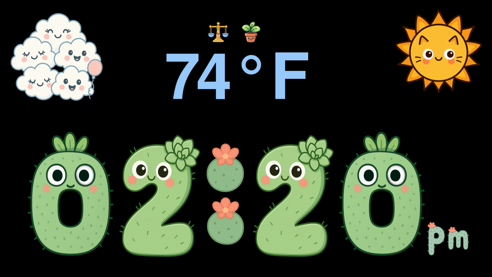

# The Clock

A fullscreen image clock created as a gift, meant to run 24/7 on a small OLED
display. It needs Python and Pygame and shows the time alongside the current
temperature and weather, drawn as cute-styled characters.

Above the temperature is a row of small **alert icons** — scales, plant,
computer, camera — each of which appears only when its endpoint says something
needs attention. Everything on screen drifts continuously and imperceptibly so
the panel does not burn in.



## Running

```bash
pip install -r requirements.txt
python3 clock.py
```

Escape or `q` quits.

| Flag | What it does |
| --- | --- |
| `--config PATH` | use a different config file |
| `--windowed` | run in a half-size window instead of taking over the screen |
| `--screenshot OUT.png` | render one frame to a PNG and exit |
| `--at HH:MM` | with `--screenshot`, pretend it is that time |
| `--alerts weight=alarm,plants=warn` | with `--screenshot`, force alert icons on |
| `--selftest` | probe every configured endpoint once, print the results, exit |
| `-v` | debug logging |

Warnings and errors go to the console and to a size-capped `error.log`
(512 KB, two rotations). Repeated identical errors are collapsed rather than
written once per poll.

## Configuration

Settings are loaded from `config.json`. Every key is optional; anything missing
falls back to the default below. Problems are reported all at once at startup
rather than one crash at a time.

### Appearance

| Key | Default | Meaning |
| --- | --- | --- |
| `theme` | `"default"` | folder under `images/` |
| `brightness_day` / `brightness_night` | `1.0` | digit brightness |
| `brightness_sun` / `brightness_moon` | `1.0` | corner icon brightness |
| `brightness_weather_day` / `_night` | `1.0` | weather icon brightness |
| `padding` | `40` | margin kept clear at the screen edges |
| `screen_width` / `screen_height` | panel native | force a logical size; the frame is scaled to the panel if they differ |
| `fps` | `30` | event-loop tick rate (not the redraw rate — see below) |

### Temperature

| Key | Default | Meaning |
| --- | --- | --- |
| `temp_endpoint` | `""` | JSON endpoint; blank means no temperature is shown |
| `temp_field` | `"Temperature"` | dotted path to the value in the response |
| `temp_unit` | `"F"` | letter printed after the degree sign |
| `temp_network_period` | `120` | seconds between polls |
| `temp_stale_after` | `7200` | hide the reading once it is this old |
| `temp_font` | `"comicsansms"` | font name; a warning is logged if it is not installed |
| `temp_font_size` | `64` | point size |
| `temp_padding_top` | `40` | gap above the alert row |
| `temp_color_day` / `_night` | white | `[r, g, b]` |
| `temp_brightness_day` / `_night` | `1.0` | multiplier on that colour |

### Weather

| Key | Default | Meaning |
| --- | --- | --- |
| `weather_endpoint` | `http://snek:8000/weather/api/condition` | JSON endpoint |
| `weather_field` | `"value"` | dotted path to the icon name |
| `weather_network_period` | `900` | seconds between polls |
| `weather_stale_after` | `21600` | hide the icon once the reading is this old |

The value must match a filename in `images/<theme>/weather/`, e.g.

```json
{ "value": "overcast" }
```

### Alerts

`alerts.items` is a list, so adding a fifth alert needs no code change — just
another entry and a PNG.

```json
"alerts": {
  "icon_size": 88,
  "icon_gap": 40,
  "gap_below": 28,
  "brightness_day": 1.0,
  "brightness_night": 0.75,
  "items": [
    { "id": "weight", "icon": "scale",
      "endpoint": "http://snek:8000/scale/api/schedule_status/mitts",
      "field": "status", "period": 300, "show_at": "alarm" },
    { "id": "plants", "icon": "plant", "endpoint": "", "period": 600, "show_at": "warn" }
  ]
}
```

| Item key | Default | Meaning |
| --- | --- | --- |
| `id` | — | unique name; also the key used by `--alerts` |
| `icon` | same as `id` | artwork basename, see below |
| `endpoint` | `""` | **blank means the icon can never appear and no request is ever made** |
| `field` | `"status"` | dotted path into the JSON body; if the body is not JSON the whole body is used |
| `period` | `300` | seconds between polls |
| `timeout` | `4` | socket timeout |
| `show_at` | `"warn"` | minimum severity that makes the icon appear: `okay`, `warn`, `alarm` or `never` |
| `stale_after` | `1800` | hide the icon if the last good reading is older than this |
| `values` | see below | extra value → severity mappings |

The endpoint just has to return a status somewhere:

```json
{ "person_key": "mitts", "status": "okay" }
```

`okay`/`ok`/`good`/`green` mean okay, `warn`/`warning`/`due`/`amber`/`yellow`/
`orange` mean warn, and `alarm`/`alert`/`critical`/`error`/`overdue`/`red`/
`fail` mean alarm. Teach it new vocabulary with `values`:

```json
"values": { "needs_weighing": "alarm", "pending": "warn" }
```

A status it does not recognise is **not** read as okay. It counts as a failed
poll: logged with the offending value, backed off, and the icon stays hidden.
Reporting health it cannot actually see would be worse than reporting nothing,
so the alerting fails closed rather than open — if the scale service starts
answering `"OVERDUE_3_DAYS"` you get a log line telling you to add it, not a
silent all-clear.

If an endpoint is failing, its icon is hidden rather than shown, for the same
reason. The failure is logged.

**Artwork.** Each icon is looked up as `images/<theme>/alerts/<icon>.png`, then
`images/alerts/<icon>.png`, and if neither exists a plain vector pictogram is
drawn instead. Shipped: `scale`, `plant`, `logs`, `camera`.

**Layout.** The row is horizontally centred above the temperature in the order
the items are declared. Its height is reserved permanently, so the temperature
and the digits never move when an icon appears or disappears.

**Colour.** Icons are drawn in their own colours; the fact that one appeared at
all is the signal. If you want severity colour-coding as well, add
`"tint": {"warn": [255,176,0], "alarm": [255,80,64]}` to the `alerts` block.

### Burn-in

An always-on clock is the worst case for an OLED: the same bright shapes in the
same place forever. Two things make burn-in *visible* — how much total light a
pixel has emitted, and how sharp the boundary is between worn and unworn
pixels. The second one is what turns wear into a legible ghost of the digits,
and it is the one that can actually be fixed.

Everything on screen therefore drifts along a slow, non-repeating path built
from three sine waves with mutually incommensurate periods, so it fills a
region instead of retracing a loop. Two details make it work:

* **It is genuinely sub-pixel.** Pygame blits on integer coordinates, so naive
  drift jumps a whole pixel at a time, and a one-pixel jump of a high-contrast
  edge is visible however rarely it happens. `blit_subpixel()` does a true
  bilinear sub-pixel shift using four ordinary blits with computed per-surface
  alpha, at about the cost of one plain blit.
* **It is slow enough to be invisible.** The peak speed is
  `amplitude · (2π/60) · mean(1/period_minutes)`, which for the shipped config
  is 0.057 px/s for the digits — one pixel every seventeen seconds. That is
  well over an order of magnitude below the speed at which a person can see a
  high-contrast edge move. The clock only redraws once something has shifted
  by `drift.quantum` (1/16 px), which averages 2.0 redraws a second over 24 h
  — about 2% of one core. At that quantum no pixel changes by more than
  5/255 between consecutive frames; at 1/8 px the worst case reaches 8/255
  across ~350 pixels, which is where stepping would start to be visible.
  Both the amplitude and the peak speed are logged at startup.

| Key | Default | Meaning |
| --- | --- | --- |
| `drift.min_x` | `48` | horizontal half-amplitude the digits are **guaranteed**; reserved out of the width. Without a floor here, a strip that grows to fill the screen leaves no horizontal slack and horizontal drift — which does most of the work — silently vanishes. Raising it trades clock size for wear: `80` → 26.5× ghost / 1.21× peak (3% smaller), `120` → 28.9× / 1.30× (8% smaller), `160` → 33.7× / 1.41× (12% smaller). |
| `drift.max_x` | `160` | cap on horizontal drift if the layout leaves more room than `min_x`. Usually free, since the digits are height-limited. |
| `drift.max_y` | `40` | vertical half-amplitude, reserved out of the digit height. Lowering it gives the digits back: `32` → 19.9× ghost reduction, `24` → 15.5×, `16` → 10.9×, `0` → 2.6×. |
| `drift.icon_max` | `40` | half-amplitude for the two corner icons, both axes. Clamped to `padding`, since they sit that far from the screen edge — they are the least-protected element, so raising `padding` buys them room. |
| `drift.top_y` | `16` | vertical half-amplitude *guaranteed* to the alert row and temperature, paid for out of the layout. The corner icons usually push the top margin further down than the temperature needs, and that slack is handed back as extra drift for free — up to `drift.max_y`. Set it to `0` to pin the top block. The alert row and the temperature share one drift path, so the gap between them never changes. |
| `drift.periods_minutes` | `[71, 113, 179]` | the three sine periods |
| `drift.quantum` | `0.0625` | redraw once anything has moved this far, in pixels |
| `drift.enabled` | `true` | set false to pin everything (useful for screenshots) |
| `digit_scale` | `1.0` | top-level: shrink the digits to buy more drift room. The digits are height-limited, so 0.92 costs 8% of their size and buys the digits a wider envelope; 0.85 more so. |

Measured over a simulated 30 days against the real artwork, with the default
config:

| | peak wear | ghost-edge contrast |
| --- | --- | --- |
| no drift at all | 1.00× | 1.0× |
| the old ±6 px jump every 5 minutes | 1.04× lower | 6.3× lower |
| this build | **1.17× lower** | **24× lower** |

That is 4.1× less ghost contrast than the build this replaces, and the motion
is no longer visible when it happens. All four drifting elements — digits,
temperature, weather icon and sun/moon icon — are modelled.

**Read those two columns differently.** Peak wear is the total light a pixel
has emitted, which is what physically ages it — and drift barely touches it,
because the strokes of these glyphs are far wider than any offset that fits on
the panel. Some uneven aging is going to happen. What drift buys is the second
column: the wear stops having *edges*. That is the difference between a legible
ghost of the digits and a soft brightness gradient with no shape to it.

Two honest caveats. This is a model — linear luminance × time, which understates
real OLED aging (roughly superlinear in drive current, and blue degrades
fastest), so treat the ratios as relative rather than as a forecast. And it
models the digit strip, not the temperature block or the corner icons. The
worst remaining spot is the colon: it is the one glyph lit 100% of the time in
the same place, and its dots are wider than the drift envelope.

To reduce the *first* column the lever is brightness, not motion:

| | peak wear vs shipped |
| --- | --- |
| as shipped (`brightness_night: 0.8`) | — |
| `brightness_night: 0.5` | 1.20× lower |
| that plus `night_dim` 01:00–06:00 at 0.35 | 1.31× lower |

`night_dim` dims the whole screen during hours nobody is looking:

```json
"night_dim": { "enabled": true, "start": "01:00", "end": "06:00", "brightness": 0.35 }
```

Re-run the analysis after changing anything:

```bash
pip install numpy pillow
python3 tools/burnin_report.py --days 30 --heatmap wear.png
```

### Location and time

| Key | Default | Meaning |
| --- | --- | --- |
| `timezone` | `"America/New_York"` | IANA name |
| `latitude` / `longitude` | `42.95` / `-72.04` | used for sunrise and sunset |
| `time_adjust` | `0` | hours added to the **displayed** time |

`time_adjust` shifts what the clock reads, and with it the weekday icon, the
moon phase and the `night_dim` window — everything you read off the panel moves
together. Sunrise and sunset still come from the real clock, so the day/night
artwork switches when the sun actually does.

### Networking

Every endpoint is polled on its own daemon thread, so a slow or dead server can
never stall the display. Failures back off exponentially to at most 15 minutes,
and a permanent failure (404, 401, …) drops to hourly and still recovers on its
own once the endpoint appears. Nothing is ever fabricated: if a reading is
missing or stale, that element is simply not drawn.

| Key | Default | Meaning |
| --- | --- | --- |
| `net_timeout` | `4` | socket timeout for temperature and weather |

## Themes

Images live under `images/<theme>/`:

```
images/<theme>/day/{0..9,colon,am,pm}.png     digits, daytime palette
images/<theme>/night/{0..9,colon,am,pm}.png   digits, night palette
images/<theme>/sun/{monday..sunday}.png       daytime corner icon
images/<theme>/moon/{new,waxing_crescent,…}.png   night-time corner icon
images/<theme>/weather/<condition>.png        weather icon
images/alerts/{scale,plant,logs,camera}.png   alert icons, shared by all themes
```

`colon`, `am` and `pm` are drawn at half width; the digits are full width. New
themes just need a new folder — `halloween` symlinks `sun`, `moon` and
`weather` back to `succulent` rather than duplicating them.

## AI/ML usage

This code was developed using [Vibe Coding](https://en.wikipedia.org/wiki/Vibe_coding)
with OpenAI's Codex and later with Claude Code. The artwork was generated using
Sora and gpt-image-2. Minimal manual editing was used for both the code and the
images.
