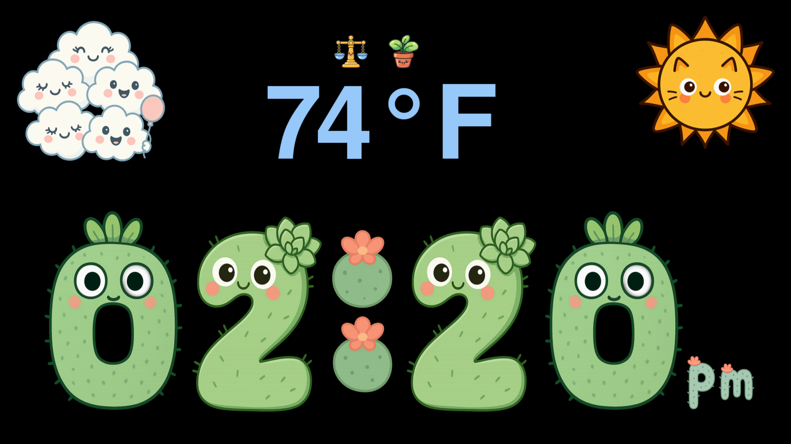

# The Clock

A fullscreen image clock created as a gift, meant to run 24/7 on a small OLED
display. It needs Python and Pygame and shows the time alongside the current
temperature and weather, drawn as cute-styled characters.

Above the temperature is a row of small **alert icons** — scales, plant,
computer, camera — each of which appears only when its endpoint says something
needs attention. Everything on screen drifts continuously and imperceptibly so
the panel does not burn in.



## Running

```bash
pip install -r requirements.txt
python3 clock.py
```

Escape or `q` quits.

| Flag | What it does |
| --- | --- |
| `--config PATH` | use a different config file |
| `--windowed` | run in a half-size window instead of taking over the screen |
| `--screenshot OUT.png` | render one frame to a PNG and exit |
| `--at HH:MM` | with `--screenshot`, pretend it is that time |
| `--alerts weight=alarm,plants=warn` | with `--screenshot`, force alert icons on |
| `--selftest` | probe every configured endpoint once, print the results, exit |
| `-v` | debug logging |

Warnings and errors go to the console and to a size-capped `error.log`
(512 KB, two rotations). Repeated identical errors are collapsed rather than
written once per poll.

## Configuration

Settings are loaded from `config.json`. Every key is optional; anything missing
falls back to the default below. Problems are reported all at once at startup
rather than one crash at a time.

### Appearance

| Key | Default | Meaning |
| --- | --- | --- |
| `theme` | `"default"` | folder under `images/` |
| `overall_brightness` | `1.0` | multiplies every brightness below, the temperature's and the alerts' included; the main burn-in lever, see Burn-in |
| `brightness_day` / `brightness_night` | `1.0` | digit brightness |
| `brightness_sun` / `brightness_moon` | `1.0` | corner icon brightness |
| `brightness_weather_day` / `_night` | `1.0` | weather icon brightness |
| `padding` | `40` | margin kept clear at the screen edges |
| `screen_width` / `screen_height` | panel native | force a logical size; the frame is scaled to the panel if they differ |
| `fps` | `30` | event-loop tick rate (not the redraw rate — see below) |
| `digit_scale` | `1.0` | shrink the digits to buy drift room; see Burn-in |

### Temperature

| Key | Default | Meaning |
| --- | --- | --- |
| `temp_endpoint` | `""` | JSON endpoint; blank means no temperature is shown |
| `temp_field` | `"Temperature"` | dotted path to the value in the response |
| `temp_unit` | `"F"` | letter printed after the degree sign |
| `temp_network_period` | `120` | seconds between polls |
| `temp_stale_after` | `7200` | hide the reading once it is this old |
| `temp_font` | `"comicsansms"` | font name; a warning is logged if it is not installed |
| `temp_font_size` | `64` | point size |
| `temp_padding_top` | `40` | gap above the alert row |
| `temp_color_day` / `_night` | white | `[r, g, b]` |
| `temp_brightness_day` / `_night` | `1.0` | multiplier on that colour |

### Weather

| Key | Default | Meaning |
| --- | --- | --- |
| `weather_endpoint` | `http://snek:8000/weather/api/condition` | JSON endpoint |
| `weather_field` | `"value"` | dotted path to the icon name |
| `weather_network_period` | `900` | seconds between polls |
| `weather_stale_after` | `21600` | hide the icon once the reading is this old |

The value must match a filename in `images/<theme>/weather/`, e.g.

```json
{ "value": "overcast" }
```

### Alerts

`alerts.items` is a list, so adding a fifth alert needs no code change — just
another entry and a PNG.

```json
"alerts": {
  "icon_size": 88,
  "icon_gap": 40,
  "gap_below": 28,
  "brightness_day": 1.0,
  "brightness_night": 0.75,
  "items": [
    { "id": "weight", "icon": "scale",
      "endpoint": "http://snek:8000/scale/api/schedule_status/mitts",
      "field": "status", "period": 300, "show_at": "alarm" },
    { "id": "plants", "icon": "plant", "endpoint": "", "period": 600, "show_at": "warn" }
  ]
}
```

| Item key | Default | Meaning |
| --- | --- | --- |
| `id` | — | unique name; also the key used by `--alerts` |
| `icon` | same as `id` | artwork basename, see below |
| `endpoint` | `""` | **blank means the icon can never appear and no request is ever made** |
| `field` | `"status"` | dotted path into the JSON body; if the body is not JSON the whole body is used |
| `period` | `300` | seconds between polls |
| `timeout` | `4` | socket timeout |
| `show_at` | `"warn"` | minimum severity that makes the icon appear: `okay`, `warn`, `alarm` or `never` |
| `stale_after` | `1800` | hide the icon if the last good reading is older than this |
| `when_stale` | `""` | instead show it at this severity (`okay`, `warn` or `alarm`), for an endpoint whose silence is itself news |
| `values` | see below | extra value → severity mappings |

The endpoint just has to return a status somewhere:

```json
{ "person_key": "mitts", "status": "okay" }
```

`okay`/`ok`/`good`/`green` mean okay, `warn`/`warning`/`due`/`amber`/`yellow`/
`orange` mean warn, and `alarm`/`alert`/`critical`/`error`/`overdue`/`red`/
`fail` mean alarm. Teach it new vocabulary with `values`:

```json
"values": { "needs_weighing": "alarm", "pending": "warn" }
```

A status it does not recognise is **not** read as okay. It counts as a failed
poll: logged with the offending value, backed off, and the icon stays hidden.
Reporting health it cannot actually see would be worse than reporting nothing,
so the alerting fails closed rather than open — if the scale service starts
answering `"OVERDUE_3_DAYS"` you get a log line telling you to add it, not a
silent all-clear.

If an endpoint is failing, its icon is hidden rather than shown, for the same
reason. The failure is logged.

**Artwork.** Each icon is looked up as `images/<theme>/alerts/<icon>.png`, then
`images/alerts/<icon>.png`, and if neither exists a plain vector pictogram is
drawn instead. Shipped: `scale`, `plant`, `logs`, `camera`.

**Layout.** The row is horizontally centred above the temperature in the order
the items are declared. Its height is reserved permanently, so the temperature
and the digits never move when an icon appears or disappears.

**Colour.** Icons are drawn in their own colours; the fact that one appeared at
all is the signal. If you want severity colour-coding as well, add
`"tint": {"warn": [255,176,0], "alarm": [255,80,64]}` to the `alerts` block.

### Burn-in

An always-on clock is the worst case for an OLED: the same bright shapes in the
same place, forever. How soon a ghost appears depends on two things, and the
clock works on both. The first is the light each subpixel emits, since that is
what physically ages it. The second is how evenly the wear is spread, because
sharp edges between worn and unworn pixels are what draw a legible ghost of the
digits.

For the light, `overall_brightness` multiplies every other brightness setting:
the digits, corner icons, weather, temperature, and alerts. Because it is
applied once when the artwork loads, it costs nothing per frame. Brightness
settings multiply sRGB code values and the panel's response follows a power
curve, which means `0.7` emits about 45% of the light rather than 70%. That
roughly matches turning the panel's own brightness button down from 310 to 140
nits. The two multiply, which means you can use either or both.

The shipped config also runs the corner icons, the weather icon, and the
temperature at 0.6 by day and the digits at 0.4 at night. Because night starts
at sunset, evenings are dimmer as well, and if they are too dark
`brightness_night` is the one to raise first.

For the wear, everything on screen drifts on a slow path whose axes are
triangle waves, straight across at a constant speed and straight back. The
vertical axis runs φ (the golden ratio) times slower, which keeps the two from
falling into a repeating loop. Within a few days the path has swept its whole
rectangle. Because the speed is constant, the path spends the same time at
every offset in its box. The previous path was a mean of three sine waves and
lingered near the middle of its range. This lingering meant the center of
every stroke wore almost as if nothing moved. The drift works because of three
details:

* It moves in genuine sub-pixel steps, which matters because pygame blits on
  integer coordinates and naive drift jumps a whole pixel at a time. A
  one-pixel jump of a high-contrast edge is visible however rarely it happens.
  `blit_subpixel()` performs a true bilinear shift with four ordinary blits at
  computed per-surface alpha and costs about as much as one plain blit.
* It is slow enough to be invisible, at a constant `4 · amplitude / period` per
  axis. For the digits in the shipped config that comes to 0.039 px/s, or one
  pixel every 26 seconds. That is well over an order of magnitude below the
  speed at which a person can see a high-contrast edge move. Each element is
  redrawn independently of the others and only once it has shifted by
  `drift.quantum` (1/16 px). At that quantum no pixel changes by more than
  5/255 between consecutive frames. At 1/8 px the worst case reaches 8/255
  across ~350 pixels, and that is where stepping would start to be visible. Both the amplitude and the speed are logged at startup.
* It follows the wall clock rather than the uptime. Because the path is a
  function of the time, a restart picks it up where it would have been instead
  of starting it over from the same point.

| Key | Default | Meaning |
| --- | --- | --- |
| `drift.min_x` | `48` | horizontal half-amplitude the digits are guaranteed, reserved out of the width. Without a floor here, a strip that grows to fill the screen leaves no horizontal slack, and horizontal drift silently vanishes. |
| `drift.max_x` | `160` | cap on horizontal drift if the layout leaves more room than `min_x`. The shipped config raises it to `200` so the digits can use the room that `max_y` frees up. |
| `drift.max_y` | `40` | vertical half-amplitude, reserved out of the digit height. Because the digits are height-limited, raising it shrinks them, and that widens their horizontal room too. The shipped config's `80` makes the digits 15% smaller and lets them drift ±188 px sideways instead of ±52. |
| `drift.icon_max` | `40` | half-amplitude for the two corner icons, both axes. Clamped to `padding`, since they sit that far from the screen edge. Raising `padding` therefore buys them room. |
| `drift.top_y` | `16` | vertical half-amplitude guaranteed to the alert row and temperature, paid for out of the layout. The corner icons usually push the top margin further down than the temperature needs, and that slack is handed back as extra drift for free, up to `drift.max_y`. Set it to `0` to pin the top block. The alert row and the temperature share one drift path, which keeps the gap between them fixed. |
| `drift.period_minutes` | `197` | one horizontal sweep, out and back. The vertical sweep takes φ times as long. Speed and redraw cost go as amplitude / period, which means a wider envelope wants a longer period: the shipped config pairs its wider envelope with `331`, which keeps the redraw cost where it was. Avoid a period that divides a day or a week, or the bright daytime artwork keeps landing on the same stretch of the path. The old `periods_minutes` key is ignored with a warning. |
| `drift.quantum` | `0.0625` | redraw once anything has moved this far, in pixels |
| `drift.enabled` | `true` | set false to pin everything (useful for screenshots) |
| `digit_scale` | `1.0` | top-level: shrink the digits to buy drift room. `drift.max_y` is the better way to spend the same size: digits 15% smaller through `digit_scale: 0.85` reach 34× from 1 m, against 59× through `max_y: 80`. |

`tools/burnin_report.py` replays a year minute by minute and compares a config
against the one panel we know the answer for. That was the first one, which
jumped ±6 px every five minutes and showed a ghost after about 15 months. Each
number below is how many times as long a config takes to reach that panel's
ghost, seen from 1 m and from 2 m. For the succulent theme:

| | from 1 m | from 2 m |
| --- | --- | --- |
| the old panel (±6 px jumps, its settings) | 1× | 1× |
| the previous build (three-sine drift, its settings) | 2.7× | 1.7× |
| this build, `overall_brightness: 1.0` | 15× | 7.7× |
| this build as shipped (`0.7`) | 59× | 30× |
| as shipped, with the default digit envelope (`max_y: 40`) | 17× | 10× |
| this build, `overall_brightness: 0.5` | 196× | 100× |

The Halloween theme does better still, at 81× and 45× respectively. The fall
theme, which the shipped config uses, reaches 145× and 58×. Most of that gain
comes from emitting less light, since its daytime artwork gives off about 60%
of what succulent's does.

The model tracks wear per subpixel and in linear light. Aging is superlinear in
drive (stress goes as L^1.7), and the lost luminance grows like
(stress × time)^0.6. Blue ages three times as fast as red and green. A ghost
only counts as far as the eye can see it at that distance on this panel's
0.0634 mm pixels. Because the constants are not published for this panel, read
the numbers as relative rather than as a forecast. Across the plausible range
of the two exponents (1.3–2.0 and 0.5–0.7) the shipped config comes out at 28×
to 117× from 1 m and 17× to 52× from 2 m.

The digits are still the most visible ghost, but only just. After the same time
on screen their ghost seen from 1 m is 0.09 of the old panel's worst. The
weather icon comes out at 0.07, the sun and moon at 0.06, and the temperature
at 0.04.

`night_dim` still works, but it is now a poor trade. A whole-canvas dim
forces a full redraw every frame, which keeps one core busy for the whole
window. The per-element night brightness settings already do that job for free.

```json
"night_dim": { "enabled": true, "start": "01:00", "end": "06:00", "brightness": 0.35 }
```

Re-run the analysis after changing anything. It needs numpy and Pillow, which
the clock itself does not:

```bash
pip install numpy pillow
python3 tools/burnin_report.py --per-element --heatmap wear.png
```

### Location and time

| Key | Default | Meaning |
| --- | --- | --- |
| `timezone` | `"America/New_York"` | IANA name |
| `latitude` / `longitude` | `42.95` / `-72.04` | used for sunrise and sunset |
| `time_adjust` | `0` | hours added to the **displayed** time |

`time_adjust` shifts what the clock reads, and with it the weekday icon, the
moon phase and the `night_dim` window — everything you read off the panel moves
together. Sunrise and sunset still come from the real clock, so the day/night
artwork switches when the sun actually does.

### Networking

Every endpoint is polled on its own daemon thread, so a slow or dead server can
never stall the display. Failures back off exponentially to at most 15 minutes,
and a permanent failure (404, 401, …) drops to hourly and still recovers on its
own once the endpoint appears. Nothing is ever fabricated: if a reading is
missing or stale, that element is simply not drawn.

| Key | Default | Meaning |
| --- | --- | --- |
| `net_timeout` | `4` | socket timeout for temperature and weather |

## Cost

Elements are redrawn one at a time, each on its own schedule, and only the
changed rectangles are copied to the screen. That matters because the redraw
is dominated by one thing — on the Raspberry Pi that drives the panel, the
digit strip's four-tap sub-pixel blit is 67 ms of a 103 ms full frame — and
every element crosses a redraw step on its own schedule. Rebuilding the whole
canvas whenever anything moved redrew the strip several times more often than
it had actually moved.

Averaged over 24 h of the previous drift path and config, at 1920x1080:

| | render + present | of one core |
| --- | --- | --- |
| Raspberry Pi 4 (the panel) | 66 ms per second | **6.6%** |
| desktop (Ryzen, software SDL) | 6 ms per second | **0.6%** |

The shipped config's 331-minute period was chosen to hold the redraw rate where
it was, an estimated 46 ms of drift redraws per second on the Pi.

Before per-element redraws the same Pi measured 10–35%, varying with where the
drift happened to be on its path. Memory is about 180 MB resident; peak during
startup is ~120 MB because the artwork is loaded, scaled and dropped one file
at a time rather than all at once.

## Themes

Images live under `images/<theme>/`:

```
images/<theme>/day/{0..9,colon,am,pm}.png     digits, daytime palette
images/<theme>/night/{0..9,colon,am,pm}.png   digits, night palette
images/<theme>/sun/{monday..sunday}.png       daytime corner icon
images/<theme>/moon/{new,waxing_crescent,…}.png   night-time corner icon
images/<theme>/weather/<condition>.png        weather icon
images/alerts/{scale,plant,logs,camera}.png   alert icons, shared by all themes
```

`colon`, `am` and `pm` are drawn at half width; the digits are full width. New
themes just need a new folder. The `halloween` and `fall` folders symlink
`sun`, `moon`, and `weather` back to `succulent` rather than duplicating them.

## AI/ML usage

This code was developed using [Vibe Coding](https://en.wikipedia.org/wiki/Vibe_coding)
with OpenAI's Codex and later with Claude Code. The artwork was generated using
Sora, gpt-image-2, and gpt-image-2.5. Minimal manual editing was used for both
the code and the images.
